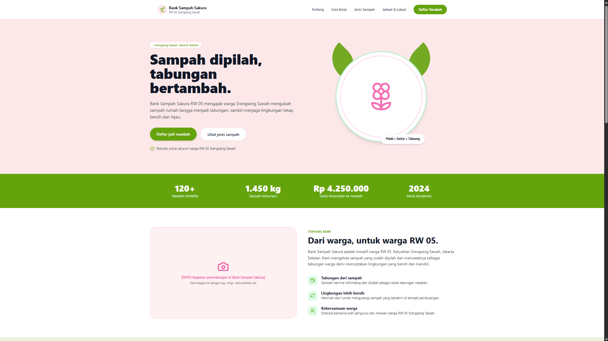
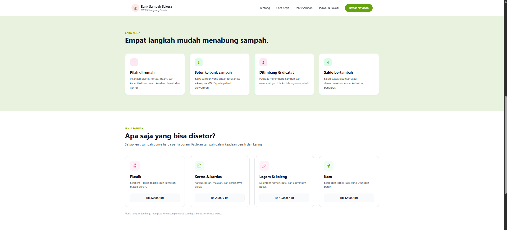
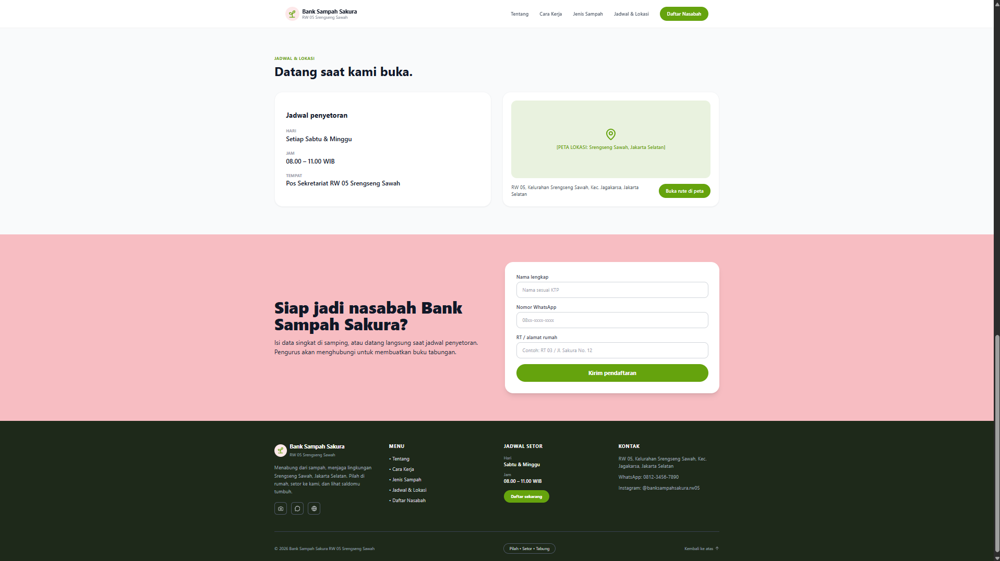

# Bank Sampah Sakura

Website **Bank Sampah Sakura** merupakan implementasi antarmuka pengguna (*Frontend*) berbasis web menggunakan ReactJS untuk layanan pengelolaan bank sampah warga RW 05, Kelurahan Srengseng Sawah, Jakarta Selatan. Proyek ini dibuat sebagai bagian dari tugas **Frontend Development – Group Challenge – UI Pages Practice** dari Celerates berdasarkan desain Hi-Fi di Figma.

## Preview Website

Berikut merupakan tampilan website Bank Sampah Sakura yang telah dibuat menggunakan ReactJS dan Tailwind CSS.





## Teknologi yang Digunakan

- **ReactJS** – Library JavaScript untuk membangun antarmuka pengguna berbasis komponen.
- **Vite** – Module bundler dan build tool untuk menjalankan serta mengembangkan proyek React.
- **Tailwind CSS** – Framework CSS untuk mengatur styling dan tata letak responsif di berbagai ukuran layar.
- **React Router DOM** – Library untuk mengatur navigasi dan routing halaman (`/` dan halaman `404 Not Found`).
- **Axios** – HTTP client untuk melakukan *networking calls* ke RESTful API pada fitur pendaftaran nasabah.
- **Lucide React** – Library ikon modern untuk mendukung elemen visual antarmuka.

## Fitur didalam Website

1. **Navigasi Responsif (`Navbar.jsx`)**  
   Menampilkan logo Bank Sampah Sakura RW 05 Srengseng Sawah, tautan navigasi *smooth-scroll* ke setiap bagian halaman (*Tentang, Cara Kerja, Jenis Sampah, Jadwal & Lokasi*), tombol **Daftar Nasabah**, serta menu *hamburger* untuk tampilan *mobile*.

2. **Hero & Statistik Operasional (`Hero.jsx` & `Stats.jsx`)**  
   Menampilkan tajuk utama *"Sampah dipilah, tabungan bertambah"*, ajakan menabung sampah bagi warga RW 05, serta ringkasan statistik jumlah nasabah terdaftar, berat sampah terkumpul, saldo tersalurkan, dan tahun beroperasi.

3. **Informasi Tentang Kami & Cara Kerja (`About.jsx` & `HowItWorks.jsx`)**  
   Menjelaskan inisiatif warga RW 05 Srengseng Sawah beserta panduan 4 langkah mudah menabung sampah (*Pilah di rumah, Setor ke bank sampah, Ditimbang & dicatat, Saldo bertambah*).

4. **Katalog Jenis Sampah (`WasteTypes.jsx`)**  
   Menampilkan daftar kategori sampah yang diterima (*Plastik, Kertas & Kardus, Logam & Kaleng, Kaca*) beserta estimasi harga per kilogram menggunakan `.map()`.

5. **Jadwal & Lokasi Penyetoran (`ScheduleLocation.jsx`)**  
   Menampilkan informasi hari, jam operasional, lokasi pos RW 05, serta tombol integrasi langsung menuju rute peta lokasi.

6. **Formulir Pendaftaran Nasabah (`RegistrationForm.jsx`)**  
   Menyediakan form pendaftaran nasabah baru (Nama Lengkap sesuai KTP, Nomor WhatsApp, dan RT/Alamat Rumah) yang dikelola menggunakan `useState` dan terhubung dengan RESTful API melalui Axios beserta penanganan pesan status (*error handling*).

7. **Footer & Routing Halaman (`Footer.jsx` & `NotFound.jsx`)**  
   Menampilkan informasi kontak pengurus, jadwal setor, tombol *scroll-to-top*, serta halaman fallback `404 Not Found` apabila pengguna mengakses rute URL yang tidak tersedia.

## Struktur Folder

```text
bank-sampah-sakura/
├── public/
├── screenshots/
│   └── bank-sampah-sakura.png
├── src/
│   ├── api/
│   │   └── axiosInstance.js
│   ├── assets/
│   ├── components/
│   │   ├── About.jsx
│   │   ├── Footer.jsx
│   │   ├── Hero.jsx
│   │   ├── HowItWorks.jsx
│   │   ├── Navbar.jsx
│   │   ├── RegistrationForm.jsx
│   │   ├── ScheduleLocation.jsx
│   │   ├── Stats.jsx
│   │   └── WasteTypes.jsx
│   ├── pages/
│   │   ├── LandingPage.jsx
│   │   └── NotFound.jsx
│   ├── App.jsx
│   ├── index.css
│   └── main.jsx
├── eslint.config.js
├── index.html
├── package.json
├── package-lock.json
├── postcss.config.js
├── tailwind.config.js
├── vite.config.js
└── README.md
```

## Cara Menjalankan Website

Ikuti langkah-langkah berikut untuk menjalankan aplikasi Frontend ini secara lokal di komputer:

1. Clone repository:

   ```bash
   git clone URL_REPOSITORY
   ```

2. Masuk ke direktori proyek:

   ```bash
   cd bank-sampah-sakura
   ```

3. Install dependencies:

   ```bash
   npm install
   ```

4. Jalankan website:

   ```bash
   npm run dev
   ```

5. Buka alamat lokal yang muncul pada terminal, biasanya:

   ```text
   http://localhost:5173
   ```

## Informasi Tugas

- **Program:** Celerates
- **Module:** Frontend Development
- **Task:** Group Challenge - UI Pages Practice
- **Mentor Trainer:** Ahmad Thomthomi Barosimi

## 👥 Team — EcoSakura

| Name | Role |
|---|---|
| Zahra Tsabitah | Project Manager |
| Rifki Budiyanto | UI/UX Designer 1 |
| Shafiq Usman Nurhananto | UI/UX Designer 2 |
| Muhammad Haikal Erlana | Frontend / Coder 1 |
| Reza Brema Ginting | Backend / Coder 2 |